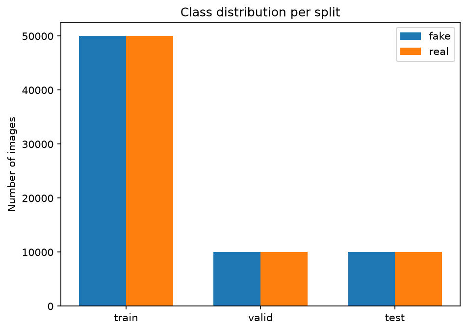
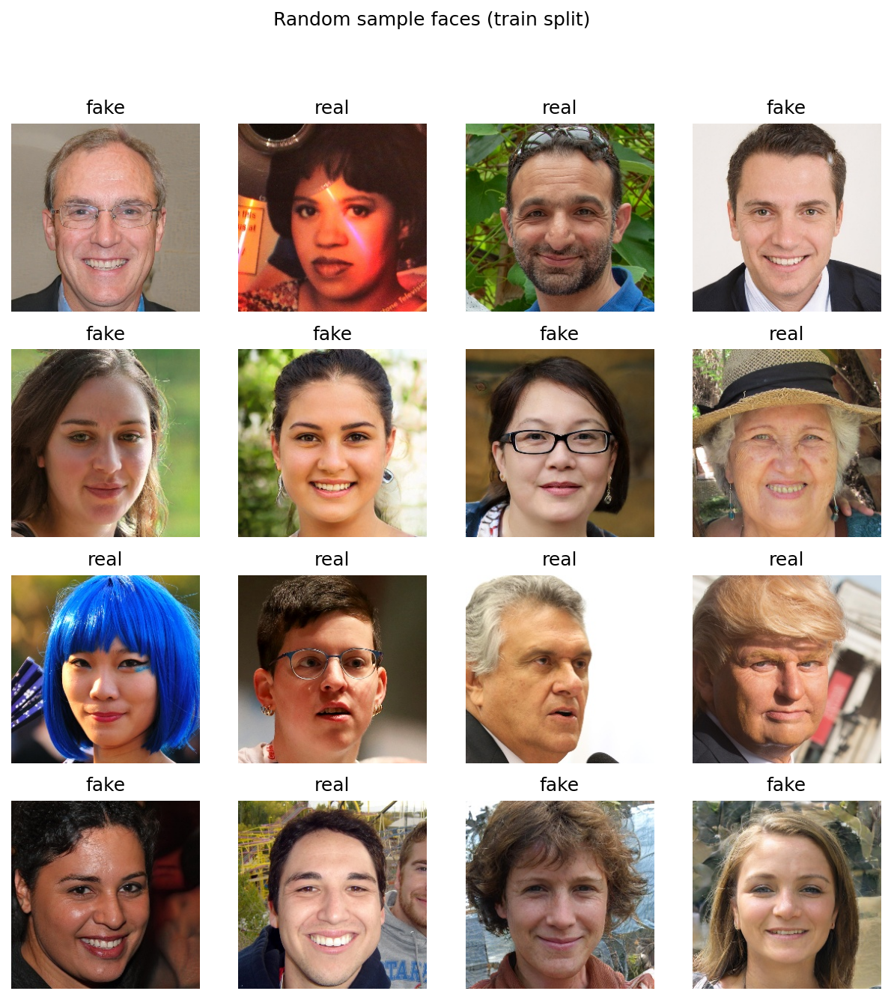

# Real vs AI-Generated Face Detection

Deep learning model that detects AI-generated faces: a custom CNN vs. a fine-tuned
MobileNetV2, with Grad-CAM explanations and a Gradio demo.

**Team:** Kashmala Saghar (23K-3034), Manahil Ayaz (23K-3018)

## Problem statement

GAN and diffusion models can generate photorealistic faces of people who don't exist, and
these are increasingly used in fake social media profiles, scams, identity fraud and
misinformation. Manual checking doesn't scale, so this project builds and compares two
CNN-based classifiers that automatically flag a face photo as real or AI-generated.

## Dataset

[140k Real and Fake Faces](https://www.kaggle.com/datasets/xhlulu/140k-real-and-fake-faces)
(Kaggle): 70,000 real photos (NVIDIA Flickr-Faces-HQ) and 70,000 StyleGAN-generated fakes,
256x256 RGB.

| Split | Real | Fake | Total |
| --- | --- | --- | --- |
| train | 50,000 | 50,000 | 100,000 |
| valid | 10,000 | 10,000 | 20,000 |
| test | 10,000 | 10,000 | 20,000 |

**Label mapping:** classes are loaded alphabetically, so **fake = 0, real = 1**. Every model
outputs `P(real)`, and all reports, plots and the app follow this convention.

Layout expected on disk: `data/real_vs_fake/real-vs-fake/{train,valid,test}/{fake,real}/*.jpg`
(the dataset's `train.csv`/`valid.csv`/`test.csv` files are ignored; the code reads the image
folders directly).

## Models

**Custom CNN** -- `src/models.py:build_cnn`: `Rescaling(1/255)` -> 4 blocks of
`Conv2D(32/64/128/256, 3) -> BatchNorm -> MaxPool` -> `GlobalAveragePooling2D` ->
`Dense(128, relu)` -> `Dropout(0.5)` -> `Dense(1, sigmoid)`.

**MobileNetV2 (transfer learning)** -- `src/models.py:build_mobilenet`: ImageNet-pretrained
`MobileNetV2(include_top=False)`, frozen at first, built functionally from
`preprocess_input` through `base.output` -> `GlobalAveragePooling2D` -> `Dropout(0.3)` ->
`Dense(1, sigmoid)`. Fine-tuned in two stages: head-only, then the top 30 base layers
unfrozen (BatchNorm layers kept frozen) at a lower learning rate.

Both are compiled with Adam / binary crossentropy, tracking accuracy, precision, recall and
AUC.

## How to run

### Setup

```bash
python -m venv venv
./venv/Scripts/activate        # Windows; use `source venv/bin/activate` on macOS/Linux
pip install -r requirements.txt
```

### 1. Get the dataset

Either download it yourself (place `kaggle.json` at `~/.kaggle/kaggle.json`, then):

```bash
python -m src.download_data
```

or place it manually at `data/real_vs_fake/real-vs-fake/{train,valid,test}/{fake,real}/*.jpg`.

### 2. Explore the data

```bash
python -m src.explore
```

Writes `outputs/metrics/dataset_counts.json`, `outputs/figures/class_distribution.png` and
`outputs/figures/sample_grid.png`.

### 3. Train

This machine has no GPU, so the real training run was done on **Google Colab's free GPU**
via the notebook below. To run locally anyway (slow on CPU, or set `TRAIN_SUBSET` in
`src/config.py` for a quick run):

```bash
python -m src.train --model cnn
python -m src.train --model mobilenet
```

### 4. Evaluate

```bash
python -m src.evaluate --model all
```

Writes per-model classification reports, confusion matrices, ROC curves and misclassified
examples to `outputs/`, plus a combined comparison table and ROC plot.

### 5. Grad-CAM

```bash
python -m src.gradcam --model cnn
python -m src.gradcam --model mobilenet
```

### 6. Gradio demo

```bash
python app/app.py
```

Loads `models/mobilenet_best.keras` (falls back to the CNN if missing), opens at
`http://127.0.0.1:7860`.

### 7. Colab (full GPU training)

Open `notebooks/ai_face_detector_colab.ipynb` in Google Colab (Runtime -> Change runtime
type -> GPU), upload your own `kaggle.json` when prompted, and run all cells. It downloads
the dataset, trains both models on the full dataset, evaluates them, renders Grad-CAM
figures, launches the Gradio demo with a public link, and ends with a cell that zips
`models/` and `outputs/` for download -- unzip those into this repo's `models/` and
`outputs/` folders afterwards.

## Results

Sample grid and class balance from the local dataset:




The comparison table, confusion matrices, ROC curves and Grad-CAM figures for both trained
models are pending the Colab GPU training run (see step 7 above). Once that run's
`models/*.keras` and `outputs/` are copied back into this repo, this section will be updated
with:

- `outputs/metrics/model_comparison.csv` / `.md` -- accuracy, precision, recall, F1, AUC,
  parameter count and training time for both models
- `outputs/figures/cnn_confusion_matrix.png`, `mobilenet_confusion_matrix.png`
- `outputs/figures/roc_comparison.png`
- `outputs/figures/cnn_gradcam.png`, `mobilenet_gradcam.png`

## Limitations

- Trained only on StyleGAN faces, so it may not generalize to diffusion-generated faces
  (e.g. Midjourney) or non-face images.
- Sensitive to compression and cropping.

## Future work

- Add diffusion-generated faces to training data.
- Try EfficientNet or ViT as alternative backbones.
- Add robustness to JPEG compression.

## References

1. Karras, T., Laine, S., & Aila, T. (2019). A Style-Based Generator Architecture for
   Generative Adversarial Networks (StyleGAN). *CVPR*.
2. Sandler, M., et al. (2018). MobileNetV2: Inverted Residuals and Linear Bottlenecks.
   *CVPR*.
3. Selvaraju, R. R., et al. (2017). Grad-CAM: Visual Explanations from Deep Networks via
   Gradient-based Localization. *ICCV*.
4. [140k Real and Fake Faces dataset](https://www.kaggle.com/datasets/xhlulu/140k-real-and-fake-faces)
   (Kaggle).

## Manual steps remaining

- Run `notebooks/ai_face_detector_colab.ipynb` on Colab's GPU and copy the resulting
  `models/*.keras` and `outputs/` back into this repo.
- Re-run `python -m src.evaluate --model all` and `python -m src.gradcam` locally (or just
  copy the Colab-generated figures) so this README's Results section can be filled in with
  real numbers.
